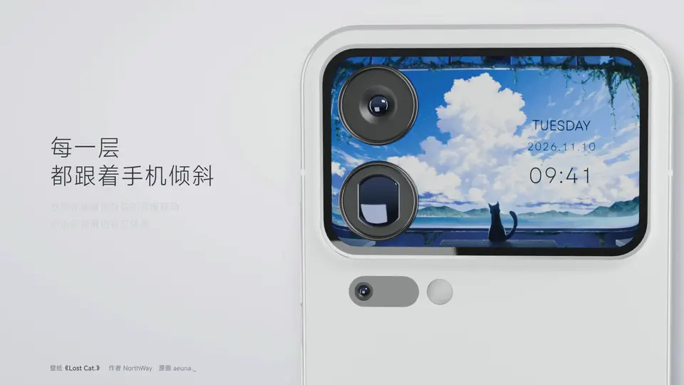
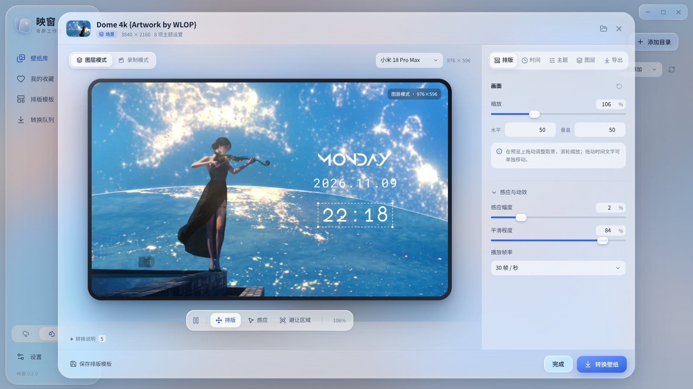
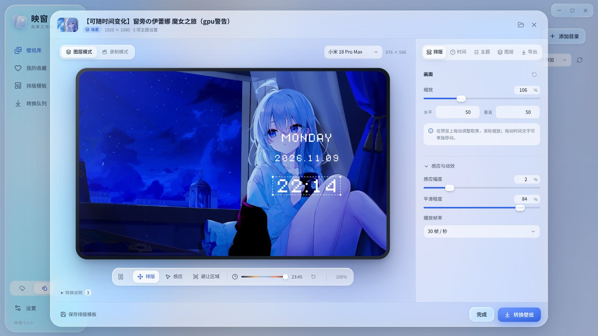
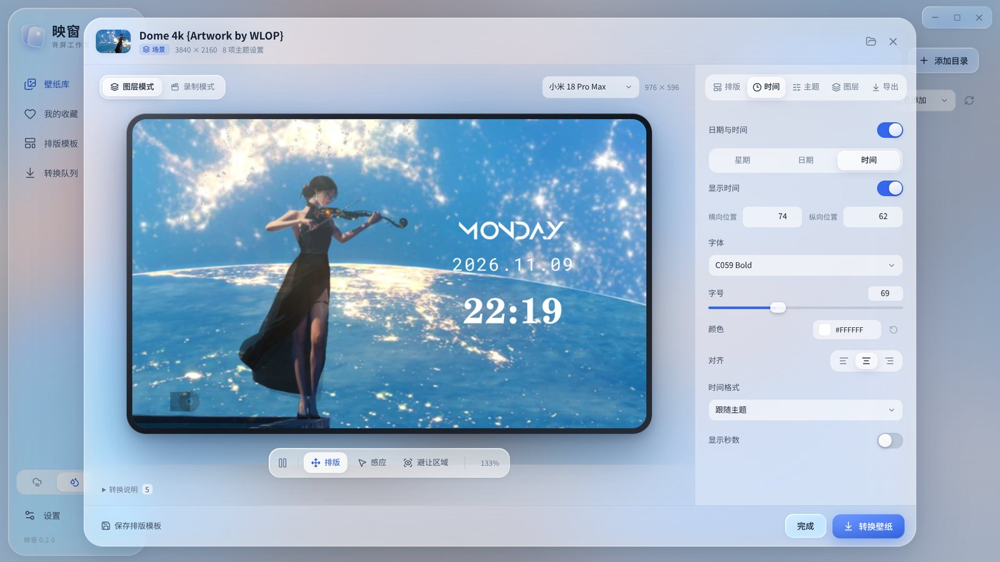
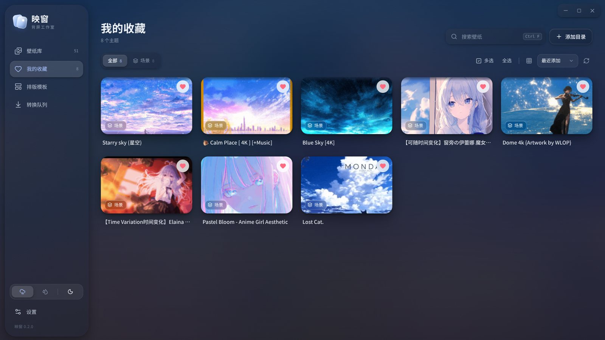

# 映窗

**把 Wallpaper Engine 壁纸搬上小米背屏**

完整特效 · 逐层视差 · 背屏组件 · 一键导出

[下载](#下载) · [功能](#功能) · [三步上手](#三步上手) · [常见问题](#常见问题) · [▶ 宣传片](https://www.bilibili.com/video/BV1JrWM6DE6N/)

[▶ 在 B 站观看完整宣传片](https://www.bilibili.com/video/BV1JrWM6DE6N/)

## 功能

| | |
| --- | --- |
| 🎬 **完整特效** | 编辑器用 WebGL（网页图形接口）实时渲染壁纸的特效、粒子与脚本，预览即电脑上的效果 |
| 🧩 **逐层视差** | 图层逐个烘焙特效后分层导出，背屏上每层独立随手机倾斜 |
| 🌗 **随时段变化** | 晨昏昼夜切换的壁纸导出后照样按系统时间切换，渐变时段保留过渡 |
| 🕒 **背屏组件** | 时间、农历、步数、天气、电量等 20 个组件，字体、字号、颜色和位置自由调整，可存为模板批量套用 |
| 📷 **真机镜头** | 预览按机型画出镜头的实际位置；主体被挡住时可水平翻转画面 |
| 📦 **自动压缩** | 按背屏实际分辨率裁切缩小 2K/4K 素材，包体通常缩小一半以上 |
| ⚡ **硬件加速** | 多窗口并行渲染图层，视频优先使用显卡硬件编码（NVENC / QSV / AMF） |
| 🪟 **玻璃界面** | 磨砂玻璃、液态玻璃两种材质，浅色、深色或跟随系统 |
| 🔄 **在线更新** | 启动时检查新版本，下载校验后自动安装 |

<table>
  <tr>
    <td></td>
    <td></td>
  </tr>
  <tr>
    <td align="center">完整特效与逐层视差</td>
    <td align="center">拖动“预览时刻”查看各时段画面</td>
  </tr>
  <tr>
    <td></td>
    <td></td>
  </tr>
  <tr>
    <td align="center">时钟字体与排版</td>
    <td align="center">磨砂玻璃 · 深色</td>
  </tr>
</table>

演示中的壁纸：《Dome 4k》壁纸作者 Drioyard、原画 WLOP；《窗旁の伊蕾娜》《闲憩微息》壁纸作者 夜莺Night、原画 あずーる azure；《Lost Cat.》壁纸作者 NorthWay、原画 aeuna._；《Starry sky》壁纸作者 ryuu、原画 防人；《Horizon（Blue Sky）》壁纸作者 Max、原画 Y_Y；《Pastel Bloom》壁纸作者 Saikeiga、原画 HioRi；《Calm Place》壁纸作者 Viwwe、原画 RicoDZ。壁纸来自 Steam 创意工坊，版权归各自作者所有。动图中的手机模型基于 Shyam Vignesh 的 [xiaomi 17 pro max](https://sketchfab.com/3d-models/xiaomi-17-pro-max-6f5ab10697614ab0b82fdc1275d4aac5)（CC BY 4.0），改为小米 18 Pro Max 白色。

## 下载

| 系统 | 下载 | 使用方式 |
| --- | --- | --- |
| Windows 10/11 x64 | [映窗 0.3.0 免安装包](https://github.com/Molun0301/yingchuang/releases/download/v0.3.0/yingchuang-0.3.0-Windows-x64.zip) | 完整解压后打开“映窗.exe” |
| Linux x86_64 | [映窗 0.3.0 AppImage](https://github.com/Molun0301/yingchuang/releases/download/v0.3.0/yingchuang-0.3.0-Linux-x86_64.AppImage) | 赋予执行权限后运行 |

安装包已包含转换运行时与 FFmpeg，无需另装 Python。[全部版本](https://github.com/Molun0301/yingchuang/releases) · [0.3.0 版本说明](docs/公开文档/版本说明-0.3.0.md)

## 三步上手

1. 打开映窗，自动读取 Steam 中的 Wallpaper Engine 壁纸，也可以手动添加目录。
2. 点开壁纸，选择机型，调整取景、组件和主题设置。
3. 点击“转换壁纸”，得到 `.mrc` 背屏主题包，按 [背屏导入指南](docs/公开文档/背屏导入指南.md) 放到手机上。未 root、Shizuku 授权和已 root 三种方式都有说明。

支持机型：小米 17 Pro、17 Pro Max、18 Pro、18 Pro Max。

### 两种导出方式

| | 图层模式（默认） | 录制模式 |
| --- | --- | --- |
| 做法 | 逐层渲染特效，背屏逐层绘制 | 录制完整画面为循环视频 |
| 感应视差 | 每层独立 | 整幅平移 |
| 随时段变化 | 保留 | 按录制时刻固定 |
| 适合 | 场景壁纸 | 网页、应用和透视三维壁纸 |

## 常见问题

Linux 上 AppImage 双击没反应？

AppImage 需要 FUSE 2。Ubuntu 24.04 及以上运行 `sudo apt install libfuse2t64`，更早的版本运行 `sudo apt install libfuse2`。

哪些效果无法还原？

作用于整幅画面的后期层（如胶片颗粒）、鼠标交互和实时音频频谱无法拆到图层。每次导出的成品目录里，“转换报告.json”会列出具体差异。需要整幅画面完全一致时可改用录制模式。

没有 root 能用吗？

可以。未 root 时借用妙享背屏“AI 生图”建立的模板，把导出的 `.mrc` 改名替换进去；进不去 `Android/data` 时用 Shizuku 授权的文件管理器。详细步骤和风险见 [背屏导入指南](docs/公开文档/背屏导入指南.md)。

手机上的效果实测过吗？

桌面端的转换、预览和打包已经过测试，手机导入、背屏运行和时段切换还没有在全部机型上实测。遇到问题欢迎提交 [Issue](https://github.com/Molun0301/yingchuang/issues)。

步数、天气组件在手机上显示为 0？

这些数据由手机系统提供：步数类组件需要安装小米健康，天气类组件需要安装小米天气并允许定位。电脑预览显示的是示例数据。

导出很慢怎么办？

首次打开壁纸时需要逐层渲染特效，结果会缓存，之后修改设置只重新渲染变化的图层。带 4K 视频的壁纸转码耗时较长，有 NVIDIA、Intel 或 AMD 显卡时会自动使用硬件编码。

## 项目统计

## 友情链接

- [LINUX DO](https://linux.do)：新的理想型社区

## 从源码构建

环境要求、构建与测试步骤见 [项目说明](docs/公开文档/项目说明.md)。

## 许可证

映窗源码以 [MIT 许可证](LICENSE) 发布。随应用分发的第三方组件保留各自的许可，见 [许可目录](build/licenses/)；其中 FFmpeg 可执行程序按 GPL-3.0 授权，由映窗以独立进程调用。

Wallpaper Engine 创意工坊壁纸及其素材的版权归壁纸作者与原画作者所有，不在本许可范围内；演示画面中的壁纸仅用于展示功能，作者见上方截图下的说明与宣传片片尾。
